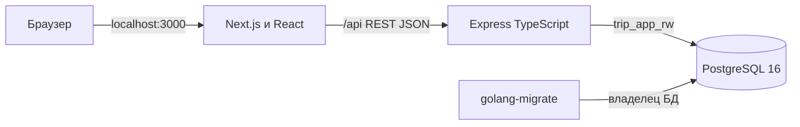
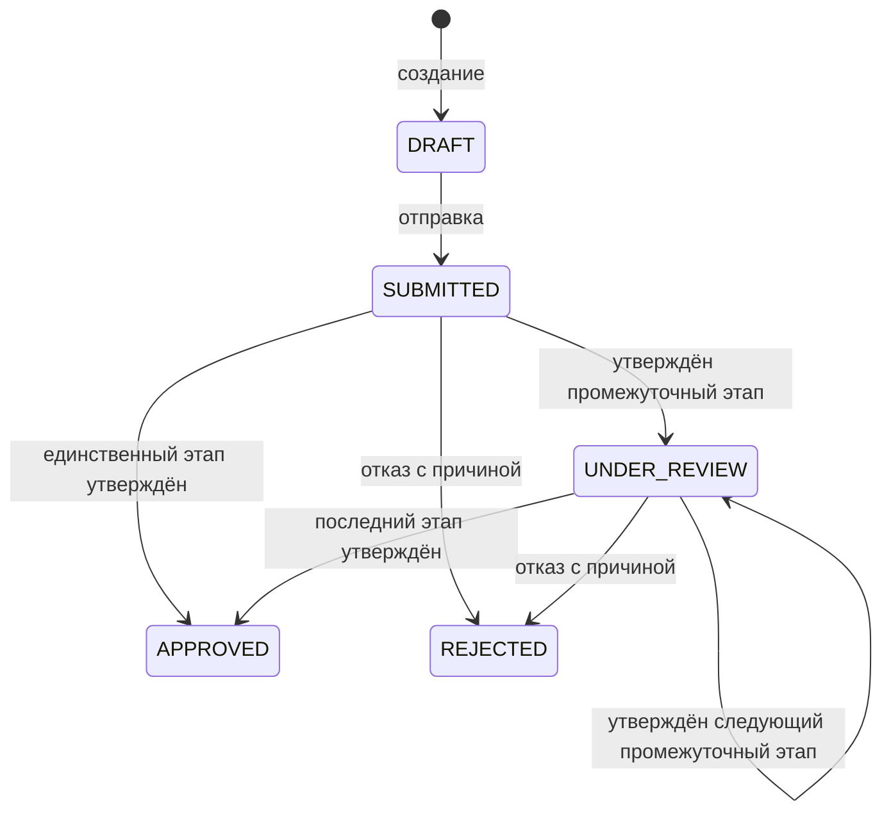
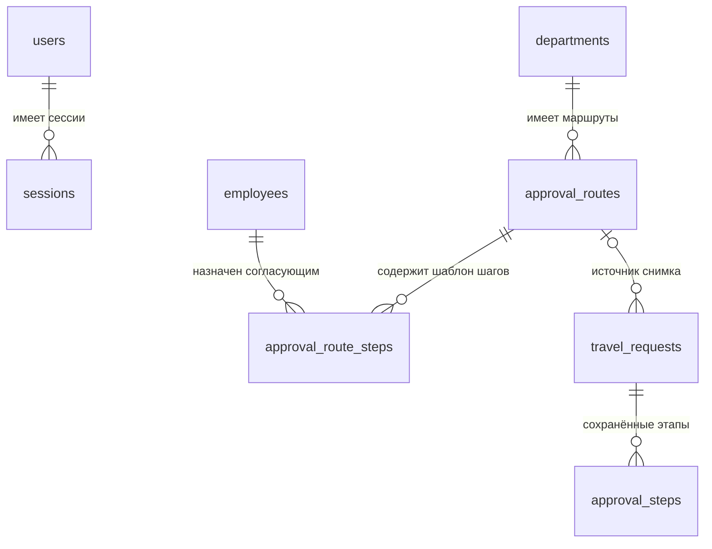

# Решения учебной версии

Дата: 29 октября 2026 года. Версия контракта: 0.2.0.

## Архитектура

Сохраняем стек отчёта этапа I. Next.js отображает интерфейс через App Router и проксирует `/api` на Express. Вход, список, создание, карточка, редактирование и очередь согласования имеют отдельные URL. Общий layout содержит меню и клиентскую проверку сессии; UI-компоненты отделены от API-методов и хуков. Фильтры списка хранятся в query-параметрах, карточка загружается по id маршрута, а не по состоянию предыдущего экрана. Express остаётся одним приложением со слоями routes → controllers → services → repositories. Контроллеры разбирают HTTP-данные, сервисы проверяют бизнес-правила и управляют транзакциями, репозитории выполняют SQL. Сессии, логирование, Origin и ошибки вынесены в middlewares, Zod-схемы — в validators, общие типы — в types, криптография — в utils. PostgreSQL используется через `pg` и SQL, без дополнительной ORM.

В Docker наружу на localhost публикуется web; API доступен по внутренней сети. PostgreSQL публикуется только на localhost для локальной разработки и SQL-консоли. Для полностью закрытого стенда публикацию порта БД можно убрать. Сетевой публичный запуск пока не настроен: для него потребуются HTTPS, корректный `APP_ORIGIN` и `COOKIE_SECURE=true`.

## Вход и доступ

Пароли хэшируются scrypt со случайной солью. Случайный токен сессии передаётся в HttpOnly SameSite=Lax cookie, в БД хранится SHA-256 токена. Сессия живёт 8 часов; выход удаляет её на сервере. Активность учётной записи и роли читаются при каждом защищённом запросе. Вход ограничен 30 попытками за 15 минут на IP; счётчик хранится в памяти одного процесса.

В production изменяющие запросы принимаются только с `Origin`, равным `APP_ORIGIN`, и с JSON Content-Type. В разработке дополнительно разрешены localhost и 127.0.0.1 на портах 3000/3001, чтобы автоматический выбор порта Next.js не блокировал вход. Это защита учебного браузерного сценария от CSRF; запросы curl также должны передавать Origin. Пользователь не выбирает автора заявки. Чужая карточка скрывается ответом 404. Согласующему доступна назначенная ему заявка; решение допустимо только на текущем этапе.

## Черновик и смета

Черновик уже при сохранении содержит обязательные поля поездки: исходная схема БД не позволяет хранить неполную поездку. Смета черновика может быть пустой; отправка требует хотя бы одну позицию. Нулевая позиция допустима, отрицательная — нет. В учебной версии используется RUB без валютной конвертации.

Суммы API представлены десятичными строками. Backend складывает целые копейки через BigInt и сохраняет NUMERIC. Предварительный итог в интерфейсе информационный; источником истины служит серверный расчёт.

Номер заявки строится из года и выделенного PostgreSQL identity. Пропуски номеров после отменённой транзакции допустимы. Изменение черновика, отправка и решение требуют текущую `version`; устаревший запрос получает 409. Поездка, смета, заявка и история меняются транзакционно.

## Маршруты согласования

Уточнение FR-11: для подразделения выбирается один активный маршрут. Шаблоны находятся в новых таблицах `approval_routes` и `approval_route_steps`; `approval_steps` содержит снимок при отправке заявки. Для сохранённых заявок миграция не меняет имеющиеся этапы. Изменение шаблона влияет только на будущие отправки. UI администрирования шаблонов в эту версию не включён.

Нельзя назначать автору согласование своей заявки. Согласующий должен быть активным и иметь роль APPROVER. Если маршрут недопустим, отправка целиком откатывается. Сотрудники-согласующие при необходимости требуют отдельного маршрута, не включающего их самих.

История статусов хранит переходы; решения каждого согласующего дополнительно хранятся в этапах. Повтор `UNDER_REVIEW → UNDER_REVIEW` не вставляется в историю, так как исходное ограничение запрещает одинаковые старый и новый статусы. При отказе оставшиеся PENDING-этапы становятся SKIPPED. `CANCELED` зарезервирован исходной моделью, операция отмены не реализована.

## История схемы

- `000001` и `000002` сохранены без изменений.
- `000003` добавляет сессии.
- `000004` добавляет шаблоны маршрутов, их шаги и необязательную ссылку заявки на шаблон.

Старая ER-модель — диаграмма в отчёте этапа I. Дополнение к ней:

Для заявок до миграции `approval_route_id` остаётся NULL. Фактические этапы продолжают работать независимо от этой ссылки. Пароль технической роли устанавливается отдельно командой `make provision`, чтобы не переписывать применённую миграцию с исходным тестовым паролем.
