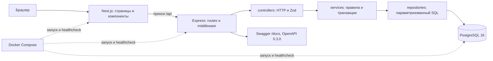
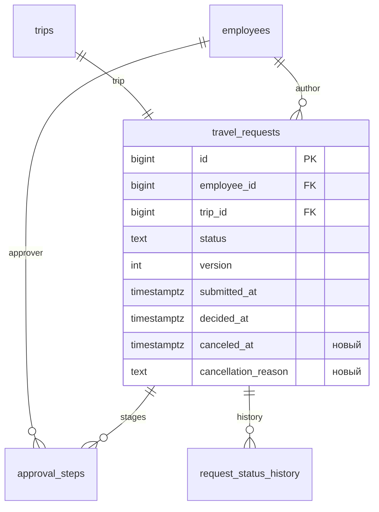

# Этап IV. Архитектура, пользовательские сценарии и защита

TripFlow, практические работы №15–22. Дата проверки: 12 ноября 2026 года. Реализация продолжает существующий проект; контракт API 0.3.0, схема БД 5. Основание — «Практические работы.pdf» и [утверждённый план](../plan-stages-4-5.md). Новые FR и критерии приёмки вынесены в [requirements.md](requirements.md).

Это технические материалы отчёта. Фактические действия выполнены в рабочей копии с помощью Codex; прежнее распределение обязанностей команды не является доказательством авторства этих изменений. Титульный лист, личный вклад участников и оформление итогового DOCX команда добавляет отдельно.

## №15. Архитектурная ревизия

### Текущая схема и ограничения



Внешних платёжных, почтовых и кадровых интеграций нет. Node.js/npm нужны для разработки и сборки, Docker — для воспроизводимого локального стенда. Сессии и бизнес-данные хранятся в PostgreSQL. Браузер не обращается к БД напрямую.

Проект учебный, команда небольшая; уже используется TypeScript/React/SQL. Точные сроки и доступное рабочее время участников не заданы. Приоритет — сохранить работающие заявки и завершить изменения в пределах этапа. Целевая нагрузка исходного NFR — 50 пользователей и 10 000 заявок; это требование, а не измеренный результат данной работы.

### Альтернативы и решение

- **Текущий модульный монолит Express + отдельный Next.js.** Один сервер бизнес-операций, общая БД и транзакции на одном соединении; текущие навыки/инструменты сохраняются. Цена — два приложения и необходимость согласовывать HTTP-типы.
- **Микросервисы заявок, согласования и входа.** Позволяют раздельно развёртывать и масштабировать подсистемы, но потребуют межсервисного доступа, доставки событий и согласования распределённых изменений. Для имеющихся сроков, команды и неподтверждённой нагрузки затраты не обоснованы.
- **Next.js с серверными обработчиками вместо Express.** Сокращает число развёртываемых приложений, но перенос работающего API и тестов создаёт дополнительный риск без новой функции для пользователя. Транзакции всё равно требуют выделенного сервисного слоя.

Решение: сохранить существующую архитектуру. HTTP-контроллеры разбирают вход, сервисы управляют правами/состояниями/транзакциями, репозитории выполняют SQL. Новое правило отмены находится в `request.service.ts`, выборка архива — в `approval.repository.ts`. React-компоненты отмены, таблицы и списка отделены от маршрутов и HTTP-клиента. Дополнительный брокер, Redis и контейнер внедрения зависимостей не вводились.

### Технический долг и безопасный порядок исправлений

1. Высокий приоритет: постепенно типизировать результаты SQL вместо неявного `any`, начиная с карточки и этапов; проверять прежние API-тесты после каждой небольшой правки.
2. Средний: генерировать общие клиентские типы из OpenAPI либо добавить полноценную проверку ответов по контракту. Сейчас типы UI и API поддерживаются вручную.
3. Средний: измерить запросы/индекс на синтетическом объёме в №23; новая пагинация устранила жёсткое ограничение очереди первыми 100 этапами, но измерения производительности ещё нет.
4. Средний: расширить браузерные проверки на мобильную ширину и другие браузеры в №25.
5. Отдельный продуктовый backlog: FR-12, восстановление пароля и управление пользователями. Изменения выполнять небольшими совместимыми миграциями, с backup и проверкой копии, без остановки разработки и reset БД.

## №16. UI/UX

### Аудитория, задачи и карта переходов

Сотрудник готовит поездку и отслеживает результат; руководитель проверяет необходимость поездки; финансист проверяет следующий назначенный ему этап. Менеджер и финансист используют одну роль APPROVER, различаются назначениями и порядком маршрута.

```mermaid
flowchart LR
  Login[/login] --> Own[/requests]
  Own --> New[/requests/new]
  New --> Card[/requests/id]
  Own --> Card
  Card --> Edit[/requests/id/edit: только DRAFT]
  Card --> Cancel[Форма отмены: причина и подтверждение]
  Own --> Pending[/approvals: ожидают решения]
  Pending <--> Processed[/approvals?view=processed]
  Pending --> Card
  Processed --> Card
  Card -->|возврат с фильтрами| Processed
```

Исходная обратная связь пользователя: после решения менеджера заявка исчезала из очереди, а первоначальная заявка не показывалась финансисту. Причины различаются: очередь показывала только текущие этапы, а старый маршрут заявки мог содержать лишь одного согласующего. Назначать финансиста задним числом нельзя; добавлен архив фактических решений и пояснения последовательности.

### Макеты и реализованный прототип

В [ui-prototype.html](ui-prototype.html) сохранены самостоятельные статические макеты: ожидающая очередь, обработанные решения и подтверждение отмены. Они объясняют композицию экранов на вымышленных данных; рабочим прототипом является приложение на localhost:3000.

Изменения: вкладки с отдельными URL; в архиве общий статус и собственное решение представлены отдельно; видны дата/комментарий; в карточке показаны число этапов и текущий шаг. Отмена открывается отдельной формой, пустая причина блокирует подтверждение; результат показывает причину, время и закрытые этапы.

### Три экспертные проверки удобства

Проверял агент в реальном Chrome на desktop, с существующим масштабом 75%. Это экспертные проходы под учебными ролями, а не исследование с тремя независимыми людьми; время выполнения и показатели удовлетворённости не измерялись.

1. **Сотрудник:** создать, сохранить, отправить и отменить заявку №5. Причина обязательна; итог CANCELED, оба этапа SKIPPED, история и время видны. Потенциальная путаница «отмена или удаление» устранена отдельным названием действия и предупреждением о невозможности повторной отправки.
2. **Руководитель:** согласовать №6, найти её в обработанных и открыть с фильтром APPROVED. В ожидании заявка исчезла, в архиве осталась со своим решением «Согласовано» при общем статусе «На согласовании». Фильтр сохранился при возврате. Исходная трудность пользователя с исчезновением заявки закрыта.
3. **Финансист и смена роли:** после менеджера увидеть №6 текущим этапом, согласовать, найти в архиве. При смене аккаунтов обнаружен возврат нового пользователя в прежнюю карточку после явного logout; исправлено различение явного выхода и истечения сессии. Повторный выход показал `/login`, новый вход — `/requests`. Также общий заголовок карточки заменён с «Мои заявки» на «Карточка заявки», чтобы чужая назначенная карточка не называлась собственной.

Скриншоты локальной проверки: [до отмены](../../output/stage-4/01-before-cancellation.png), [после отмены](../../output/stage-4/02-canceled.png), [решение менеджера в архиве](../../output/stage-4/03-manager-processed.png), [два решения](../../output/stage-4/04-final-approved.png). Каталог output исключён из Git; перед передачей преподавателю нужно приложить выбранные изображения отдельно. Скриншоты содержат окно локального браузера.

## №17. БД, миграции и качество данных

### Изменение модели

Ранее `travel_requests` содержала статус/версию/время отправки и окончательного решения; время и причина отмены отдельно не хранились. После `000005` добавлены nullable `canceled_at TIMESTAMPTZ` и `cancellation_reason TEXT`. Связи и старые столбцы сохранены. Архив читает существующие `approval_steps`, отдельная архивная таблица не нужна.



CHECK требует у CANCELED время и непустую причину длиной до 2000 символов, у остальных статусов — оба поля NULL. Частичный индекс обработанных решений: `(approver_employee_id, decided_at DESC, id DESC) WHERE status IN ('APPROVED','REJECTED')`. Индекс соответствует фильтру/сортировке, но ускорение пока не измерялось; сравнение EXPLAIN/нагрузки относится к №23.

### Миграция и сохранность

До обновления: версия 4, две заявки, три этапа и семь записей истории. Создана копия `backups/tripflow-2026-11-12T09-35-57.997Z.dump`; исходники/незакоммиченные изменения сохранены в `output/stage-4/source-before.zip` и patch. Старые миграции и Docker volume не переписывались.

Проверка `scripts/verify-stage4-migration.mjs` восстановила отдельную временную БД: сравнила количество и хэши строк всех 14 таблиц до/после up, затем после down; новые столбцы исключены из сравнения старой модели. Дополнительно проверены CHECK и две синтетические старые отмены. Все проверки прошли; временная БД удалена самим скриптом. [Результат](../../output/stage-4/migration-check.json).

Совместимость старых CANCELED: дата берётся из истории отмены, иначе из `updated_at`; причина — последний непустой комментарий отмены, иначе явная пометка «Причина отмены не сохранялась в предыдущей версии». `updated_at` в таком случае — совместимая оценка времени, а не восстановленная достоверная дата события. В исходной рабочей БД отмен не было; случаи проверены на копии.

Затем применена версия 5 к рабочей БД. До новых браузерных действий все прежние строки/столбцы 14 таблиц совпали с копией: [проверка рабочей миграции](../../output/stage-4/live-migration-check.json). После этого через UI добавлены только две помеченные учебные заявки №5 и №6. Исходные заявки №1 и №3 не изменялись: после всех проходов повторно совпали хэши их заявок, поездок, этапов, смет и истории — [итоговая проверка](../../output/stage-4/final-data-check.json). Выход/вход закономерно изменяет таблицу sessions.

### Примеры операций

```sql
-- Чтение собственных обработанных этапов, значения передаются параметрами.
SELECT request_id, status, decided_at, decision_comment
FROM trip_app.approval_steps
WHERE approver_employee_id = $1 AND status IN ('APPROVED', 'REJECTED')
ORDER BY decided_at DESC, id DESC LIMIT $2 OFFSET $3;

-- Фрагмент отмены внутри одной транзакции после блокировки/проверок сервиса.
UPDATE trip_app.travel_requests
SET status='CANCELED', canceled_at=now(), cancellation_reason=$2,
    version=version+1, updated_at=now()
WHERE id=$1;
UPDATE trip_app.approval_steps SET status='SKIPPED'
WHERE request_id=$1 AND status='PENDING';
INSERT INTO trip_app.request_status_history
  (request_id,old_status,new_status,changed_by_employee_id,comment)
VALUES ($1,'SUBMITTED','CANCELED',$2,$3);
```

Новый сценарий создаёт историю, читает решения и обновляет заявку/этапы. Удаление обработанных/отменённых записей не добавлялось: они сохраняют аудит. Прежний CRUD черновика остаётся в `request.repository.ts`. CHECK проверен прямыми ошибочными UPDATE на тестовой БД, не только через UI.

## №18. Серверная логика и бизнес-правила

FR-13 выражается правилами: если пользователь не автор или без EMPLOYEE, он не отменяет заявку; если версия устарела, возвращается 409; если состояние не SUBMITTED или уже есть APPROVED/REJECTED, отмена запрещена; если все условия выполнены, все изменения фиксируются вместе.

```mermaid
sequenceDiagram
  participant UI
  participant C as Контроллер
  participant S as RequestService
  participant DB as PostgreSQL
  UI->>C: POST /requests/id/cancel {version,reason}
  C->>C: сессия, Origin, Zod
  C->>S: cancelRequest(user,id,version,reason)
  S->>DB: BEGIN; SELECT своей заявки FOR UPDATE
  S->>DB: проверка версии, статуса и решений
  S->>DB: CANCELED + время/причина + version
  S->>DB: PENDING → SKIPPED; INSERT истории
  S->>DB: COMMIT
  S-->>UI: 200, обновлённая карточка
```

Маршрут/контроллер находятся в `routes/request.routes.ts` и `controllers/request.controller.ts`, схема — `validators/request.validation.ts`. Бизнес-операция — `services/request.service.ts`; SQL — репозитории заявок и согласования. Одна транзакция передаёт один client всем записям. Решения согласующих тоже сначала блокируют заявку, затем этап; одинаковый порядок сериализует конкурирующие действия.

`submitted_at` сохраняется, `decided_at` остаётся NULL при отмене. CANCELED терминален; после первого положительного решения статус становится UNDER_REVIEW либо APPROVED, что также закрывает отмену. Возможность `can_cancel` в ответе помогает UI, но все условия повторно проверяются внутри транзакции.

Тесты: успешная отмена; черновик; повтор/устаревшая версия; пустая/слишком длинная причина; чужой автор; отозванная роль; первое решение уже принято; конкурентные отмена/согласование. Гонка возвращает один 200 и один 409, история/этапы согласованы с победившим действием. Исполнялись на отдельной временной БД.

## №19. API и совместимость

- `POST /api/requests/{id}/cancel`: EMPLOYEE, автор; тело `{ "version": 2, "reason": "Рабочая встреча перенесена" }`, успех 200 с карточкой.
- `GET /api/approvals?view=pending&page=1`: APPROVER, текущие назначенные этапы.
- `GET /api/approvals?view=processed&decision=APPROVED&from=2026-11-01&to=2026-11-30&page=1`: собственные решения; `from/to` ограничивают даты поездки, не дату решения.

`view` по умолчанию pending, `page` — 1, размер страницы фиксирован 20. `page` допускает 1–100000. `decision` разрешён только при processed, даты ISO и правильный порядок обязательны. Ответ списка: `items`, `total`, `page`, `page_size`, `view`; в элементах добавлены `approval_id`, `step_order`, `approval_status`, `approval_decided_at`, `approval_comment`. Идентификаторы и NUMERIC остаются строками.

Карточка дополнена `canceled_at`, `cancellation_reason`, `can_cancel`. Ошибки имеют прежний формат `{ "error": { "message": "..." } }`: 400 — входные данные, 401 — сессия, 403 — роль/Origin, 404 — отсутствие доступной заявки, 409 — версия/состояние, 415 — не JSON. Ошибки валидации дополнены `error.fields`; requestId передаётся заголовком X-Request-Id, а при 500/503 также внутри error. Пример конфликта: «Заявка уже изменена. Обновите карточку».

[OpenAPI](../api/openapi.yaml) версии 0.3.0 содержит схемы, параметры, права, ответы и примеры. Swagger: http://localhost:3000/docs, исходник: `/docs/openapi.yaml`. Автотест разбирает YAML, разрешает внутренние ссылки и проверяет обязательность параметров пути; это не полноценный специализированный OpenAPI-валидатор. Фактические структуры и правила дополнительно проверены интеграционными тестами и рабочим UI.

Старый клиент, читающий `items` без параметров, продолжает получать ожидающие этапы. Прежнее усечение первыми 100 заменено страницами по 20: внешним клиентам с большим списком потребуется обработка `page/total`. Frontend обновлён одновременно. Новые поля добавлены без переименования прежних; ранее сохранённые назначения не меняются.

## №20. Аутентификация и авторизация

### Матрица доступа

| Операция                          | Без сессии | EMPLOYEE                    | APPROVER                 | ADMIN без остальных ролей |
| --------------------------------- | ---------- | --------------------------- | ------------------------ | ------------------------- |
| Вход                              | Доступен   | Доступен                    | Доступен                 | Доступен                  |
| Свой список/карточка              | 401        | Свои                        | Свои                     | Свои                      |
| Создать/изменить/удалить черновик | 401        | Свой DRAFT                  | Только при EMPLOYEE      | Только при EMPLOYEE       |
| Отправить/отменить                | 401        | Свой, по правилам состояния | Только при EMPLOYEE      | Только при EMPLOYEE       |
| Очередь/архив решений             | 401        | 403 без APPROVER            | Только свои назначения   | 403 без APPROVER          |
| Чужая карточка/история            | 401        | 404                         | Только назначенная       | 404 без APPROVER          |
| Решение                           | 401        | 403 без APPROVER            | Только свой текущий этап | 403 без APPROVER          |

Роли суммируются. ADMIN не является универсальным обходом бизнес-правил; административного UI нет. Отсутствие назначения скрывается через 404. Назначенный следующий согласующий может читать карточку до своего хода, но принимать решение раньше предшественников нельзя.

### Жизненный цикл сеанса

Пароль хранится как scrypt с индивидуальной случайной солью, сравнение — `timingSafeEqual`. Вход создаёт случайный токен 32 байта; в PostgreSQL сохраняется SHA-256 токена, браузер получает `tripflow_session`. Cookie: HttpOnly, SameSite=Lax, Path=/, 8 часов; Secure управляется COOKIE_SECURE. На локальном HTTP Secure выключен; публичный HTTPS здесь не настраивался.

Каждый защищённый запрос проверяет срок сессии, `users.is_active` и заново читает роли. Выход удаляет серверную сессию и очищает cookie. Очистка истёкших сессий выполняется при входе; отдельной фоновой задачи пока нет. JWT и localStorage для токенов не используются.

Проверены верный/неверный вход, отсутствие/истечение/удаление сессии, отключение пользователя, изменение ролей, чужая карточка, очередь, порядок этапов, logout и повтор прежнего токена. Исправлен доступ к чужой назначенной карточке после отзыва APPROVER; регрессионный тест проверяет и историю. Исправлен повреждённый scrypt-хэш: теперь отказ во входе вместо ошибки длины буфера и 500.

## №21. Интеграция frontend/API

### Связь действий и серверных операций

| Элемент UI              | Эндпоинт                             | Ожидаемая реакция                           |
| ----------------------- | ------------------------------------ | ------------------------------------------- |
| Войти / выйти           | POST auth/login / auth/logout        | Сессия и переход /requests; выход на /login |
| Мои заявки и фильтры    | GET requests                         | Свой список, total и страницы               |
| Сохранить форму         | POST requests / PATCH requests/id    | Карточка нового/изменённого DRAFT           |
| Удалить черновик        | DELETE requests/id                   | Возврат к своему списку                     |
| Отправить               | POST requests/id/submit              | SUBMITTED, снимок этапов, история           |
| Вкладки, решение и даты | GET approvals с query                | Ожидающие либо собственные обработанные     |
| Открыть карточку        | GET requests/id                      | Смета, этапы, история и допустимые действия |
| Подтвердить отмену      | POST requests/id/cancel              | CANCELED, причина/время, закрытые этапы     |
| Согласовать/отклонить   | POST approvals/id/approve или reject | Обновлённые статус/этапы/история            |

В таблице URL указаны относительно `/api`. Реализация использует `services/requests.ts`, `services/approvals.ts`, общий HTTP-клиент и хуки `useResource`/`useApiAction`. После успешного действия карточка обновляется. Ошибки действия показываются; при 409 пользователь может нажать «Обновить карточку». Ответ 401 сбрасывает клиентскую сессию и ведёт на вход с безопасным next, 403 показывает отказ. Повторная отправка кнопок блокируется на время операции. Списки имеют индикатор загрузки, пустое состояние и повтор запроса при ошибке.

### Сквозные проверки 12 ноября

**B-01, отмена:** maxim → создать №5 «Казань — учебная отмена IV», 20–22 ноября, 12000.50 → сохранить → отправить → открыть отмену → убедиться, что пустое подтверждение недоступно → указать «Учебная проверка IV: встреча перенесена до первого решения» → подтвердить. Итог CANCELED; причина/время и оба SKIPPED видны. У менеджера и финансиста заявка в ожидании отсутствует. Серверный запрет решения по отменённой заявке дополнительно подтверждён API-тестом.

**B-02, два согласующих:** maxim → создать №6 «Тула — учебное согласование IV», 25–26 ноября, 9000.25 → отправить → manager видит свой текущий этап → согласовать → UNDER_REVIEW → очередь пуста, обработанные содержат решение → фильтр APPROVED → открыть/вернуться, фильтр сохранён → выйти → finance видит №6 в ожидании → согласовать → APPROVED и две даты/комментария → ожидающие пусты, обработанные содержат финансовое решение. Исходная №3 также осталась в архиве финансиста; №1 не назначалась ему и там отсутствует.

Реальный UI соответствует макетам по действиям, разделению статусов и текстам. В макетах нет сетевой логики; обработка loading/error и права реализованы в приложении. Браузером подтверждены успешные, пустые состояния и обязательность причины; ошибки 400/401/403/409 и пагинация 20+1 проверены на API, а отображение ошибок дополнительно проверено чтением компонентов. Переходы всех ошибок кликами и браузерная пагинация большого списка отдельно не выполнялись.

## №22. Защита приложения и данных

### Данные и границы проверки

Хранятся учебные учётные записи, имена/почта сотрудников, поездки, расходы, комментарии, решения и история, парольные хэши и хэши сессий. Основные угрозы: доступ другого сотрудника, обход последовательности/отзыва роли, подмена суммы/автора, повтор или гонка действий, CSRF, инъекции, утечка токенов/секретов, перебор пароля. Проверки выполнялись только на собственном локальном стенде и изолированных тестовых БД.

### Риски, проверки и исправления

| Риск                                           | Проверка                                                   | Результат                                  | Исправление/защита                                   |
| ---------------------------------------------- | ---------------------------------------------------------- | ------------------------------------------ | ---------------------------------------------------- |
| Чтение по старому назначению после отзыва роли | Удалить APPROVER в тестовой БД, повторить карточку/историю | Дефект найден и закрыт; теперь 404         | `findVisible` учитывает текущую роль                 |
| Повреждённый парольный хэш даёт 500            | Неверные salt/digest/число частей                          | Дефект закрыт, проверка false              | Проверка формата до timingSafeEqual, dummy scrypt    |
| Чужой автор, раннее/повторное решение          | Подмена id, другой этап, повтор, устаревшая version        | 403/404/409 по назначению ошибки           | Проверки на сервере, не только скрытие кнопок        |
| Гонка отмены/решения                           | Параллельные запросы к одной отправленной заявке           | Один 200, один 409                         | Одна транзакция, блокировка заявки первым действием  |
| Подмена итоговой суммы/владельца               | Передать лишние поля                                       | Автор берётся из сессии, сумма пересчитана | Валидация DTO и серверный расчёт                     |
| SQL-инъекция                                   | Спецсимволы/SQL-текст в полях, некорректные фильтры        | Текст сохраняется как данные либо 400      | Параметры `$1…`, статические SQL-колонки             |
| CSRF/несоответствующее тело                    | Чужой/отсутствующий Origin, text/plain, плохой JSON        | 403 / 415 / 400                            | Allowlist Origin, JSON-only, SameSite=Lax            |
| Утечка сессии/пароля                           | Ответы auth и перехват тестовых журналов                   | Секреты/тела не обнаружены                 | HttpOnly, hash в БД, структурные логи без тела       |
| Истёкший/отозванный доступ                     | Истечение, удаление сессии, inactive                       | 401, logout токен повторно не работает     | Чтение актуального состояния из БД                   |
| Перебор входа                                  | Превысить лимит на тестовом сервере                        | 429                                        | 30 попыток / 15 минут на IP                          |
| Известные уязвимости зависимостей              | npm audit --omit=dev --audit-level=high                    | 0 известных на дату проверки               | Результат относится только к production-зависимостям |

Пользовательские строки отображляются текстовыми React-узлами; `dangerouslySetInnerHTML` для заявок не используется. Хранение инъекционного текста проверено API-тестом; полноценное браузерное XSS-исследование не проводилось. Helmet применяется к API, лимит JSON — 128 KB. `.env`, backup и output исключены из Git; секреты в отчёт/команды публикации не добавлялись. Исключение из Git само по себе не заменяет управление секретами.

### Повторная проверка и ограничения

`node scripts/test.mjs`: **26 тестов, 26 успешно, 0 ошибок, 0 пропусков**. Сюда входят регрессии двух исправлений безопасности, проверки правил/доступа, OpenAPI-ссылок, криптографии и URL возврата. Полный лог — [api-tests.log](../../output/stage-4/api-tests.log). TypeScript, production-сборки и форматирование проверены; Compose после обновления healthy. Старый процент покрытия этапа III к изменённому коду не переносится.

Ограничения: лимитер входа в памяти одного процесса и сбрасывается при рестарте; восстановление пароля, MFA и администрирование не реализованы; публичный TLS не настроен; нет независимого пентеста и формальной проверки всех контрактов. Не подтверждены другие браузеры, 360 px и нагрузка 50/10000. Откат миграции 5 удаляет новые сведения об отмене, поэтому down предназначен для проверки копии; рабочий rollback требует совместимой старой версии либо отдельного плана восстановления. Эти пункты не объявляются выполненными работами V этапа.

## Воспроизведение

Обновление и команды — в [runbook](../runbook.md). Для проверки миграции нужен backup именно версии 4:

```bash
node scripts/verify-stage4-migration.mjs backups/копия-версии-4.dump
make test
npm run typecheck
npm run format:check
npm run build
```

Тесты создают и удаляют собственные временные БД. Браузерные учебные заявки №5/№6 оставлены как примеры нового поведения; прежние рабочие заявки сохранены. Материалы V этапа (№23–28) пока являются планом.
